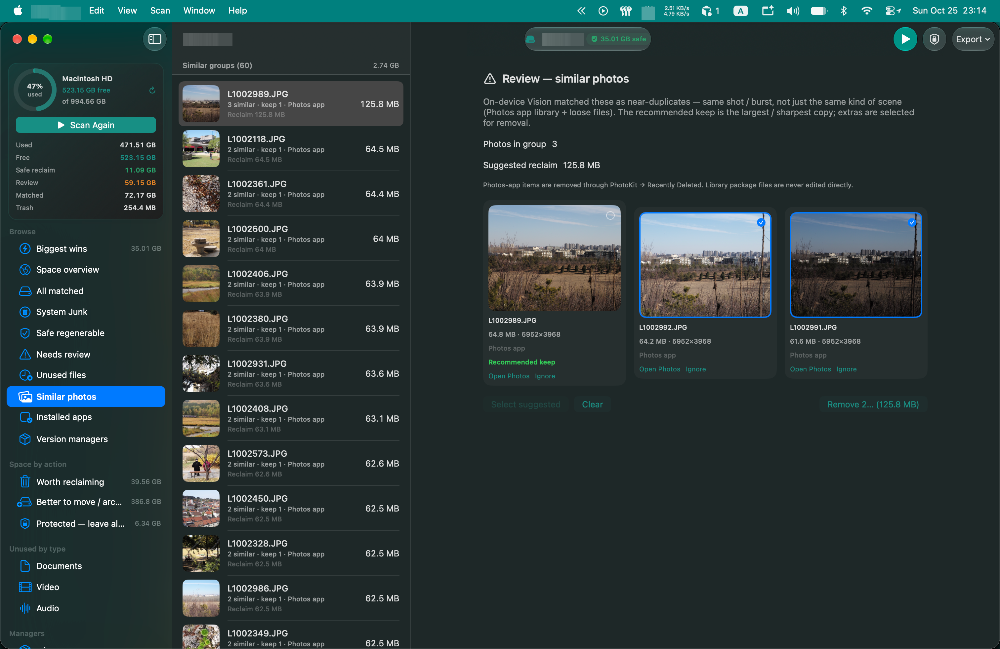

**Update (Nov 2026):** The cleaner is named **[MacHygienist](https://machygienist.app)**. Landing page: [machygienist.app](https://machygienist.app).

My 1TB MacBook Pro filled up every few weeks. Same orange warning: disk almost full. I would open CleanMyMac, clear a few gigabytes of caches and logs, and two days later hit **950 GB+** again.

CleanMyMac handles what it knows: caches, logs, language files. My free space was eaten by developer folders with names I would never search for, nested six levels under a sync root, holding tens or hundreds of gigabytes.

So I built a native macOS cleaner (now [MacHygienist](https://machygienist.app)). Not because the world needs another cleaner. I needed a tool that showed where the bytes went, and which trees were safe to delete.

## Manual cleanup did not stick

Before writing a line of Swift, I had already done the usual checklist:

- Uninstalled apps I no longer used
- Moved ~**200 GB** of photos to an external drive
- Uploaded a pile of files to a cloud drive
- Deleted local LLMs I had downloaded but rarely used
- Emptied Trash and cleared Downloads

It was never enough. Free space rose, then used space climbed again. Something large had been there all along, and none of the usual tools looked for it. `du -sh * | sort -h` could show sizes. It could not tell me which hundred-gigabyte trees were safe to delete. At volume root it is also slow, noisy, and still hits `Operation not permitted` on SIP/TCC-gated paths even with `sudo`.

## Space map and features

The app started as a space map: walk the Data volume, size large folders, and label reclaimable vs. personal vs. leave-alone. Then I added features I needed while cleaning this same Mac:

- **Biggest wins**: ranked reclaim opportunities in plain language, not a passive folder list
- **Browse all contents**: drill-down when the map stopped too shallow
- **Guidance labels**: Reclaim / Archive / Protected, so I did not delete the wrong tree
- **Similar photos**: Vision (and later PhotoKit) to cluster near-duplicates in the Photos library
- **Emulator / simulator inventory**: iOS CoreSimulator, Android AVDs, and Huawei images, with apps you can remove selectively
- **Android SDK package panel**: platforms, system images, NDK, CMake, build-tools, without opening Studio first
- **Honest sizing**: allocated bytes instead of sparse logical size (DerivedData once reported ~40 GB; on disk it was ~300 MB), plus a size cache that invalidates ancestors when a child shrinks

*Similar photos in the cleaner: on-device Vision groups near-duplicates; keep the sharpest, reclaim the rest.*

That last point mattered more than it sounds. After deleting a large cache, the parent folder's mtime often **does not change**, so a naive cache keeps serving the old multi-hundred-GB number. I saw a project as still huge when it was already cleaned. Fixing the cache was as important as finding the junk.

## The 175 GB CleanMyMac never mentioned

The find was simple and late.

Deep under a sync folder → `projects` → a workspace → a Next.js app, a **`.next`** directory held roughly **175 GB**. Almost all of it was Turbopack / dev cache under `.next/dev`. Regenerable. Safe to delete. Outside CleanMyMac's idea of "system junk."

That one folder explained months of disk-full warnings. I had been deleting small caches while a 175 GB tree sat untouched.

The other large find was **Cursor**. Its global `state.vscdb` (a SQLite store for chat and agent history) had grown to ~**60 GB**. Not photos. Not projects. A product database with a known growth problem. ⌘⇧P → **Developer: Delete Old Chats…** then **Developer: GC Agent KV Blobs** cut some of it (~**40 GB → ~21 GB**), but the file stayed large. I backed it up and deleted it to finish the reclaim.

Other finds:

- **Android SDK / tools** under `~/Library/Android`: NDK, CMake, emulator images from one-off experiments. Android Studio's SDK Manager hides half of them unless you tick **Show Package Details**, so I had "cleaned" the list and still had gigabytes left
- **iOS simulators** with large installed apps and data (one iPhone sim alone was in the teens of GB)
- **Photos** still large after the external-drive move; similarity clustering made the remaining duplicates visible

Each of these lives in a different corner of the filesystem. A cleaner that only knows `/Library/Caches` will never see them. A volume map that lets you keep clicking does.

## What I reclaimed on Oct 25

Still iterating on the cleaner, still cleaning as I go. Notable wins and fixes that day:

| What | Roughly |
|------|---------|
| Android Studio SDK Manager cleanup (NDK and friends) | **~8.8 GB** in one pass; SDK tree went from ~**35 GB → ~10 GB** after further uninstalls |
| Cursor `state.vscdb` | GC ~**40 → ~21 GB**; then backup + delete for the rest of the ~**60 GB** peak |
| Stale `.next` size after delete | Parent project UI still showed **~155 GB** after delete; on disk it was already **~18 GB** (cache bug, not a second 128 GB) |
| DerivedData "40 GB" scare | Measurement fix; real footprint ~**300 MB** |

Product work that day for the next round: Refresh that actually remeasures, an Android "installed packages" breakdown, simulator app drill-down, and collapsing the Archive view so parent/child folders are not listed as peers (Users → Home → sync → projects used to look like four separate 100 GB problems).

## Totals so far

Between the early checklist (photos off-box, cloud uploads, LLM deletes) and finds from the map (`.next`, Android SDK, simulators, editor databases, and ongoing browse sessions), I have reclaimed **500+ GB**. The Mac currently has hundreds of gigabytes free. There is more under Library, more under sync roots, and more in simulators I have not opened in a year.

## What I learned building the tool I needed

1. **Generic cleaners optimize for common cases.** Developer machines are not those cases.
2. **Hierarchy beats flat "largest folders."** If you sort every nested path by size, you double-count the same bytes and hide the structure. Show the top of a subtree; drill for the rest.
3. **Caches fail in two places.** Apps keep build artifacts forever. Your disk tool can also cache stale sizes. Both will report wrong totals.
4. **Safety labels matter.** "Safe regenerable" (`.next`, DerivedData) is a different action from "archive to external" (photos, sync trees) and from "leave alone" (System, VM, Preboot). One Trash button for all three is how people delete the wrong tree.
5. **Using the app on this Mac is the roadmap.** Every confusing screen was a screen I got stuck on while trying to free space on this laptop.

The warning banner is gone, and I know why it kept coming back. The app is [MacHygienist](https://machygienist.app).

If your Mac is full and you have already run CleanMyMac: do not buy a bigger SSD first. Inspect large trees under project roots, `~/Library`, and editor state databases. The 175 GB directory is often named something you have never searched for.
