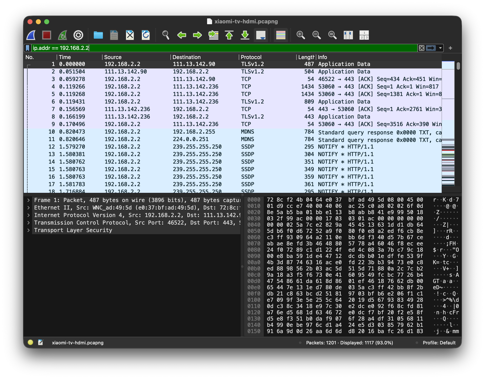

I recently read about [LG and Samsung ACR tracking](https://www.ucl.ac.uk/news/2024/nov/smart-tv-tracking-raises-privacy-concerns): smart TVs fingerprinting what is on screen (and audio) and shipping a surprising amount of data to vendor servers, even when you use the set as a dumb HDMI display. The Samsung side of those writeups stuck with me more: audio-style content recognition on the network, which reads a lot like the TV "listening" to what you are watching. I have a Xiaomi Mi TV in the living room. I wanted to know what *mine* talks to when I am not opening Netflix or YouTube.

So I put the TV behind a Mac Internet Sharing AP, captured with Wireshark, and listed destinations from DNS and TLS SNI. That is Part 1 below. The more interesting half, Part 2, is still on my todo list: force the traffic through a proxy and try to decrypt HTTPS bodies with mitmproxy and ADB. I have not done that yet. When I get a quiet evening with the living-room setup free, that is next.

Device under test: Xiaomi `MiTV4-ANSM0` (DHCP hostname). TV IP on the capture LAN: `192.168.2.2`. Capture files are linked in the table so you can open them yourself.

## Part 1: who does the TV call?

### Why "same Wi-Fi, open Wireshark" does not work

My first instinct was wrong. I sat on the home SSID, pointed Wireshark at the Wi-Fi interface, and expected to see the TV. A normal AP only forwards unicast to the real destination. The laptop never gets those HTTPS sessions. You need the capture machine **on the path**.

What I ended up with:

```text
Internet → iPhone cellular
              ↓ USB tethering (en7 on the Mac)
             Mac
              ↓ Internet Sharing Wi-Fi AP (bridge100, gateway 192.168.2.1)
             Xiaomi TV
```

A few Mac gotchas that burned an evening:

- Share **from** `iPhone USB`, **to** Wi-Fi. Do not also join the iPhone's Wi-Fi hotspot. One radio cannot be client and AP at once.
- Leave Wi-Fi powered on, but not joined to the home SSID, while Sharing is the AP. Power Wi-Fi off and you get no `bridge100`.
- Capture on `bridge100`, not `ap1`.
- Filter: `ip.addr == 192.168.2.2`.
- Empty Sharing Wi-Fi password: SSID shows up, TV cannot join. Put a password.

To pull hostnames without decrypting TLS I used:

```text
dns
tls.handshake.type == 1
```

That second filter is Client Hello. SNI is still in the clear there, so you see the hostname the TV asked for even when the rest of the session is encrypted.

### Two captures

I ran two windows on purpose: sit on the Wi-Fi settings screen and do nothing, then switch to HDMI from the cable set-top box and watch like a normal evening.

| File | Scenario | Duration | Packets |
|:-----|:---------|---------:|--------:|
| [`xiaomi-tv-baseline.pcapng`](/assets/captures/xiaomi-tv-baseline.pcapng) | Idle on the Wi-Fi settings screen | ~6.9 min | 1852 |
| [`xiaomi-tv-hdmi.pcapng`](/assets/captures/xiaomi-tv-hdmi.pcapng) | HDMI input from the cable set-top box | ~3.0 min | 1201 |

Durations are not equal, so I compare hostnames, not raw counts. Most bytes to `239.255.255.250` (SSDP) and `224.0.0.251` (mDNS) are just LAN discovery on the Sharing subnet. I ignore those for the Xiaomi cloud question.



That is the HDMI file filtered to the TV. You can see TLS to the internet and a pile of SSDP/mDNS noise. Bodies stay opaque. Hostnames do not.

### Destinations I saw

**In both captures**

| Host | Role (from the name / public docs, not from decrypted body) |
|:-----|:------------------------------------------------------------|
| `tracking.miui.com` | MIUI tracking (TLS SNI in both) |
| `pb-m.sp.gitv.tv` | Gitv / Mi content stack |
| `file.market.xiaomi.com`, `video.market.xiaomi.com` | market / video market |
| `appstore.cdn.pandora.xiaomi.com`, other `*.cdn.pandora.xiaomi.com` | CDN / packages / updates |
| `package.box.xiaomi.com` | package delivery |
| `app.znds.com` | third-party TV app catalog |

**Only while idle on Wi-Fi settings**

| Host | Role (name-level) |
|:-----|:------------------|
| `data.mistat.xiaomi.com` | Xiaomi mistat stats |
| `tracker.xiaomixiaoai.com` | XiaoAI tracker |
| `access.speech.xiaomixiaoai.com` | XiaoAI speech access |
| `grayconfig.xiaomixiaoai.com` | XiaoAI remote config |
| `resolver.mi.xiaomi.com` | Xiaomi resolver |
| `broker.mqtt.pandora.xiaomi.com` | MQTT broker |
| `milink.pandora.xiaomi.com` | Mi Link / cast related |
| `upgrade.ptmi.gitv.tv` | Gitv upgrade |

**Only on HDMI**

| Host | Role (name-level) |
|:-----|:------------------|
| `gstat.ptmi.gitv.tv` | Gitv stats (TLS SNI; large conversation in the HDMI file) |
| `openapi.shafa.com` | third-party TV API |

Switching to HDMI did not shut up `tracking.miui.com`. It added Gitv stats traffic on top.

### What I can and cannot claim

I can claim:

- The TV opens DNS and HTTPS to Xiaomi / MIUI / XiaoAI / Gitv hosts while sitting on the Wi-Fi settings UI.
- `tracking.miui.com` shows up again when the picture is HDMI from the set-top box.
- Baseline still has some cleartext HTTP. One request to `upgrade.ptmi.gitv.tv` carries a `deviceid=` query param (plus product/build fields). That is a stable device id in the clear. Most of the rest is TLS.

I cannot claim the JSON inside TLS: event names, ACR hashes, mic samples, screenshot fingerprints. After the handshake, Wireshark is looking at ciphertext.

Hostname reading is also not a payload dump. Names like `tracking`, `mistat`, `gstat`, and `tracker` point at analytics endpoints. Store and CDN names are weaker; those can be updates and assets. `access.speech.xiaomixiaoai.com` means the speech stack got contacted. It does not prove the mic recorded audio in that window.

Bottom line for Part 1: I cannot read the encrypted bodies yet, but I can show the TV keeps talking to Xiaomi tracking and related cloud hosts while idle and while on HDMI. That is enough for me to reject "it only uses the network when I open a smart app."

If you want to rebuild the hostname lists:

```bash
TSHARK=/Applications/Wireshark.app/Contents/MacOS/tshark
BASE=assets/captures  # or wherever you saved the downloads

$TSHARK -r $BASE/xiaomi-tv-baseline.pcapng -Y 'dns.flags.response == 0' \
  -T fields -e dns.qry.name | sort | uniq -c | sort -nr

$TSHARK -r $BASE/xiaomi-tv-baseline.pcapng -Y 'tls.handshake.type == 1' \
  -T fields -e tls.handshake.extensions_server_name | sort | uniq -c | sort -nr
```

Same commands against `xiaomi-tv-hdmi.pcapng`.

## Part 2: decrypt the bodies (not done yet)

Destinations answer "who." They do not answer "what fields." For that I need the TV to talk TLS to a proxy I control, so I can log the request and then open a fresh TLS session to the real server. Plan: mitmproxy on the Mac, point the TV's HTTP proxy at it, install the mitmproxy CA on the TV (ADB if I can), and see how much actually decrypts.

I have not run this end-to-end on the living-room set yet. Below is the playbook I want to follow, plus the Android trust traps I already know will matter.

### What I need

1. mitmproxy / mitmweb on the Mac, listening on the Sharing LAN (`192.168.2.1:8080`).
2. TV HTTP proxy pointed there (Wi-Fi advanced proxy, or ADB).
3. mitmproxy CA on the TV so it accepts the proxy's server certs.
4. ADB if the set exposes it, for pushing the cert, setting the proxy, and listing packages.

### Why this often fails on stock Android TV

From Android 7 on, apps do **not** trust user-installed CAs by default. The system CA store is what most apps use.

| Approach | What I expect on a stock Mi TV |
|:---------|:-------------------------------|
| User CA | Settings / WebView might work. Native Xiaomi / Gitv apps often fail TLS or never send traffic I can read. |
| System CA | Needs root (or a writable system image). Then more apps decrypt. |
| Certificate pinning | App ignores my CA even in the system store. Those flows stay opaque. |

ADB helps with install and proxy config. It does not remove pinning, and without root it often does not give system trust.

### Playbook when I get to it

Keep Internet Sharing up (`bridge100` = `192.168.2.1`):

```bash
# once: brew install mitmproxy
mitmweb --listen-host 192.168.2.1 --listen-port 8080
```

mitmweb UI defaults to `http://127.0.0.1:8081`. CA files land under `~/.mitmproxy/` (`mitmproxy-ca-cert.pem` / `.cer`).

Enable ADB on the TV (About → tap Build number, then Developer options → USB / network debugging), then:

```bash
adb connect 192.168.2.2:5555
adb devices

adb shell settings put global http_proxy 192.168.2.1:8080
# clear later:
# adb shell settings put global http_proxy :0

adb push ~/.mitmproxy/mitmproxy-ca-cert.cer /sdcard/Download/mitmproxy-ca-cert.cer
```

Install the cert from storage on the TV (wording varies: Security, Privacy, Credentials). If the TV ignores `http_proxy`, set a manual proxy in the Wi-Fi UI for the Sharing SSID instead.

If I somehow get a writable `/system` (unlikely on a retail Mi TV):

```bash
HASH=$(openssl x509 -inform PEM -subject_hash_old -in ~/.mitmproxy/mitmproxy-ca-cert.pem | head -1)
cp ~/.mitmproxy/mitmproxy-ca-cert.pem /tmp/${HASH}.0

adb root
adb remount
adb push /tmp/${HASH}.0 /system/etc/security/cacerts/
adb shell chmod 644 /system/etc/security/cacerts/${HASH}.0
adb reboot
```

Success looks like request paths and JSON in mitmweb for flows that use the proxy, trust the CA, and do not pin. I would also dump packages to map hosts to apps:

```bash
adb shell pm list packages | grep -iE 'miui|mistat|xiaoai|mitv|gitv|analytics'
```

### If decrypt fails

| Symptom | Likely cause |
|:--------|:-------------|
| No TV traffic in mitmproxy | Proxy not applied; TV bypasses global HTTP proxy |
| TLS errors / online features break | CA not trusted, or pinning |
| CONNECT tunnels, no body | TLS not intercepted |
| Only browser decrypts | User CA only; apps exclude user CAs |

Even without a full decrypt I can still extend Part 1: longer equal-length idle vs HDMI diffs, a DNS sinkhole (AdGuard Home / Pi-hole) with per-client logs, or disable analytics packages on the device and remeasure destinations.

## Where I am

| Claim | Status |
|:------|:-------|
| TV contacts Xiaomi tracking hosts on Wi-Fi settings | Observed (`tracking.miui.com`, mistat, XiaoAI tracker/speech DNS) |
| TV still contacts tracking on HDMI | Observed (`tracking.miui.com`; plus `gstat.ptmi.gitv.tv`) |
| Cleartext device id on the wire | Observed (HTTP `deviceid=` to `upgrade.ptmi.gitv.tv` in baseline) |
| Exact telemetry fields inside TLS | Not observed yet |
| Proxy + CA decrypt | Not done; next session when I get the setup free |

Part 1 already changed how I think about the set: idle and HDMI are not "offline." Part 2 is where I find out what those tracking hosts actually receive.
