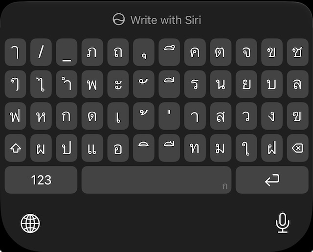
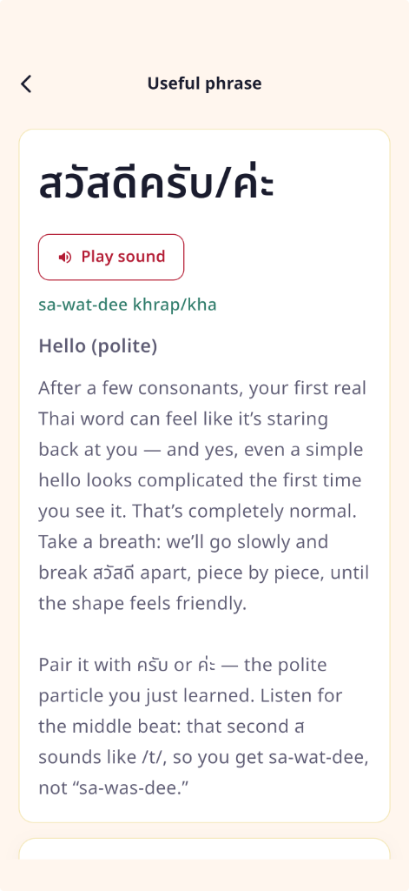

{: width="360" }

*The 5-row Thai keyboard on iPhone. That is a lot of keys.*

In [Demystifying สวัสดีครับ](/2026/11/07/demystifying-sawatdee-khrap.html) I took the greeting apart letter by letter. Then I tried to type it.

Typing Thai is not trivial either. The 5-row keyboard can be intimidating. That is why I wrote this: for myself, and hopefully it is useful for others too.

I assume you already know the pieces: **ส ว ั ส ด ี** plus **ค ร ั บ** (or **ค่ะ**). If not, start with the reading post.

## Set up the 5-row Thai keyboard

On iPhone: Settings → General → Keyboard → Keyboards → Add New Keyboard → Thai.

When Thai is active, open the keyboard layout menu (tap and hold the globe, or use the keyboard settings gear on some iOS versions) and pick the **5-row** Thai layout. That one tracks the physical **Kedmanee** board Thais grow up with. The compact layouts save space; they also move letters around enough that a beginner’s search gets noisy. I stick with 5-row for this drill.

## How the layout is organized

Thai needs roughly **44 consonants**, a stack of **vowel signs**, **four tone marks**, plus numerals and punctuation. A phone still only has one key per finger-slot. **Kedmanee** (แป้นพิมพ์เกษมณี), the default Thai layout since mid-20th-century typewriters and later Thai Industrial Standard 820, solves that with frequency.

Rules of thumb:

1. **Common symbols stay unshifted.** High-frequency consonants, everyday vowels, and the two busy tone marks (**่**, **้**) sit on the face you see. Rare consonants and Thai digits hide under Shift.
2. **The top character row is not a number row.** Unshifted you get letters and vowels (**ภ**, **ถ**, **ุ**, **ึ**, **ค**, **ต**, **จ**, **ข**, **ช**, …). Thai numerals live on Shift of that row. Western `123` is a separate toggle on the bottom left. English habit says “top row = digits.” On Thai, that row was given to letters instead.
3. **Vowels and tones are mixed into the consonant rows.** There is no “consonant block, then vowel block.” The home-ish row (row 3 in the photo: **ฟ ห ก ด เ ้ ่ า ส ว ง …**) puts frequent consonants (**ก**, **ด**, **ส**, **ว**) next to the preposed vowel **เ** and the tone marks **้** / **่**. Row 2 holds short vowels and marks such as **ะ**, **ั**, **ี**. Row 4 holds more vowels (**แ**, **ิ**, **ื**, **ใ**, …) beside consonants like **ป**, **อ**, **ท**, **ม**.
4. **Marks that sit above or below a letter are still their own keys.** **ั**, **ี**, **ิ**, **ุ**, **่**, **้** look like small signs between full consonants. They are full keys. You type the consonant, then the mark; the phone stacks the glyph.
5. **Five rows on iOS means four character rows + the system row.** Rows 1-4 are Kedmanee. Row 5 is `123`, space, and return (plus globe / mic). Compact Thai layouts on iPhone collapse or reshuffle this map. 5-row keeps the physical-board geography so tutorials and muscle memory transfer.

A crude map of the screenshot:

| Row | Job on the unshifted 5-row board |
| --- | --- |
| 1 | Frequent consonants + below-line vowels (**ุ**, **ึ**); not Western digits |
| 2 | More consonants + short vowels / above-line marks (**ะ**, **ั**, **ี**) |
| 3 | Home mix: **ฟ ห ก ด** · **เ ้ ่ า** · **ส ว ง** … |
| 4 | Shift · more consonants / vowels (**ป แ อ ิ ื ท ม ใ ฝ**) · delete |
| 5 | `123` · space · return |

Now the structure is clear, but some letters I just learned seemed to be missing.

They are not missing. Thai has two common drawings for the same letters.

## Loopless in the app, looped on the keys

**Loopless / cut-head Thai** (ตัวไม่มีหัว / หัวตัด): a modern, reduced face. Designers drop or flatten the head loops so Thai sits next to Latin sans-serif type. A lot of apps, signs, and UI chrome use this. [NidNoi](https://nidnoi.dev), where I first learned <strong class="thai-loopless">สวัสดีครับ</strong>, shows the greeting this way:

{: width="320" }

*[NidNoi](https://nidnoi.dev): loopless <strong class="thai-loopless">สวัสดีครับ/ค่ะ</strong>.*

**Looped Thai** (ตัวมีหัว, “with heads”): many consonants start with a small circle, the *hua* (หัว). School charts and handwriting train that look. The iPhone 5-row keycaps in the screenshot above use this form too.

Same letter. Different drawing. <strong class="thai-loopless">ส</strong> in NidNoi and <strong class="thai-looped">ส</strong> on the phone key are both “so sua.” I had drilled the loopless form. The keycap kept the head loop.

Side by side: <strong class="thai-loopless">ส</strong> (NidNoi / loopless) · <strong class="thai-looped">ส</strong> (keycap / looped).

That was my “missing alphabet” moment. My eye was hunting for the NidNoi glyph. The board was showing the looped version of the *same* character. Look again at row 3: <strong class="thai-looped">ส</strong> sits two keys left of the right edge, next to <strong class="thai-looped">ว</strong>. Once I stop requiring the app drawing, those two keys are easy to find.

Thai typography treats this as a real design choice, not a beginner bug. Loopless faces win a lot of display and interface work. Looped faces still dominate long reading and, on current iOS, these keyboard labels. Day one for me: **the letter I learned and the keycap can look different and still be the same key.**

## Shift holds the rare consonants (not these ones)

That frequency split shows up again here. The photo is the **unshifted** layer. Less common consonants live under the up-arrow Shift key: letters for names and Sanskrit-heavy spellings, not for **สวัสดีครับ**.

## Tap order for สวัสดีครับ

Thai vowels and marks are typed in **logical order**: the base consonant first, then the mark that sits above or below it. I do not hunt for a precomposed **วั** or **ดี** block. I build them.

| Step | Key | Where on the 5-row board | Notes |
| --- | --- | --- | --- |
| 1 | ส | Row 3, near the right | first /s/ |
| 2 | ว | Row 3, immediately right of ส | |
| 3 | ั | Row 2, middle cluster | *mai han-akat*; sits above ว → **วั** |
| 4 | ส | Row 3 again | second ส (the one that sounds like /t/ when spoken) |
| 5 | ด | Row 3, left-middle | |
| 6 | ี | Row 2, right of ั | long *i*; sits above ด → **ดี** |
| 7 | ค | Row 1, right-middle | start of **ครับ** |
| 8 | ร | Row 2, right of ี | |
| 9 | ั | Row 2 again | sits above ร → **รั** |
| 10 | บ | Row 2, near the right | final **บ** → spoken /p/ |

Female speakers swap the ending for **ค่ะ**: **ค** + **่** (tone mark, row 3 center) + **ะ** (row 2).

The floating marks (**ั**, **ี**, **่**, **้**, …) look like punctuation, not “letters.” They are still full keys. If I only scan for big consonant glyphs, I skip the vowels that finish the word.

Ten taps. One greeting I can actually send. It is also the longest hello (in time spent) that I have ever typed. But now I know how.
