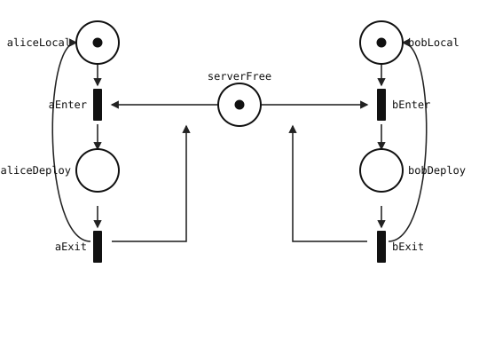

Parts [I](/2026/11/06/automata-basics-for-coders-part-1/)–[IV](/2026/11/10/automata-basics-for-coders-part-4/) stayed with languages and single machines: accepters, NFAs, [transducers](/cs-glossary/transducer/). Real software is rarely one machine. Two processes, one lock, a bounded queue: **several control flows share resources**. That is concurrency, and a single Moore diagram for “the whole system” gets painful fast.

**Petri nets** are a standard way to draw that sharing. They are not a Linz chapter. Useful references: Murata’s survey (*Petri Nets: Properties, Analysis and Applications*, Proc. IEEE, 1989) and Reisig, *Understanding Petri Nets*.

Content:

1. A real problem: two teammates, one staging server  
2. Why one finite automaton is awkward here  
3. Petri net vocabulary (as we need it)  
4. Model the staging protocol  
5. Enabling, firing, and a short scenario  
6. Reachability graph = DFA  
7. What the DFA answers: exclusion, B-safe, deadlock  
8. Design checklist  
9. Cheat sheet and self-check  

---

## The problem

Alice and Bob ship features to the **same staging server**.

Rules the team agrees on:

1. Only **one** deploy may run at a time (staging is a [mutex](/cs-glossary/mutex/)).  
2. Each person is either **working locally** or **deploying**.  
3. Starting a deploy takes the server; finishing a deploy frees it.  
4. Nobody may start a deploy while the other already holds staging.

Questions we actually care about:

- Can both be deploying at once under this protocol?  
- Can the system get stuck with nobody able to move?  
- Is there a bound on how “crowded” any local condition can get?

We will model this protocol as a Petri net, step through events by hand, then build a small DFA whose states are the global configurations.

---

## Why not just draw one big DFA first?

Alice alone is a tiny two-state machine: `Local ⇄ Deploying`.  
Bob is the same.  
The **server** is another two-state machine: `Free ⇄ Busy`.

The real system is their **product under a coupling**: Alice may enter `Deploying` only when the server is `Free`, and that move makes the server `Busy`. Drawing the full product by enumerating triples `(Alice, Bob, Server)` works for three bits—and that is exactly what we will recover below—but the Petri-net drawing stays **local**. Each resource and each person is a place or two; the coupling is a shared arc pattern. When you add a third teammate or a second lock, you extend the net instead of redrawing an exponential state box from scratch.

So: problem first → net that mirrors the protocol → reachability DFA for the hard questions.

---

## Vocabulary

| Term | Meaning | Example |
|------|---------|---------|
| **Place** (circle) | a local condition, state, or resource bucket that holds tokens | `serverFree`, `aliceLocal` |
| **Transition** (bar/box) | an event or action that can fire | `aEnter` (Alice starts a deploy) |
| **Token** (dot/count) | sits in a place; the condition holds, or one resource unit is available | a token in `serverFree` means staging is free |
| **Arc** | directed arrow: place → transition (input) or transition → place (output) | `aliceLocal` and `serverFree` into `aEnter`; `aliceDeploy` out |
| **Marking** | token count across every place at once = one global configuration (often a digit string) | `10101` = both local, server free |

**Initial marking** $M_0$: how many tokens sit where at start.

Think of a token as “this condition holds” or “this resource unit is available.” In our story:

- a token in `aliceLocal` means Alice is working locally;  
- a token in `serverFree` means staging is free.

---

## Model the staging protocol

### Places

| Place | Meaning when it holds a token |
|-------|-------------------------------|
| `aliceLocal` | Alice is local |
| `aliceDeploy` | Alice is deploying |
| `bobLocal` | Bob is local |
| `bobDeploy` | Bob is deploying |
| `serverFree` | staging is free |

Alice is always in exactly one of her two places; same for Bob. The server lock is a single token that moves into a deploy place indirectly: taking it removes `serverFree`.

### Transitions

| Transition | Consumes (inputs) | Produces (outputs) | English |
|------------|-------------------|--------------------|---------|
| `aEnter` | `aliceLocal`, `serverFree` | `aliceDeploy` | Alice starts deploy |
| `aExit` | `aliceDeploy` | `aliceLocal`, `serverFree` | Alice finishes |
| `bEnter` | `bobLocal`, `serverFree` | `bobDeploy` | Bob starts deploy |
| `bExit` | `bobDeploy` | `bobLocal`, `serverFree` | Bob finishes |

All arc weights are $1$ (one token in, one token out per arc).

### Initial marking

Alice local, Bob local, server free:

$$
M_0:\quad
\texttt{aliceLocal}{=}1,\ 
\texttt{aliceDeploy}{=}0,\ 
\texttt{bobLocal}{=}1,\ 
\texttt{bobDeploy}{=}0,\ 
\texttt{serverFree}{=}1
$$

Digit string, places in that order: **`10101`**.

Initial net ($M_0$). Circles are places, thin bars are transitions, black dots are tokens, arrows are arcs. Alice's cycle on the left, Bob's on the right, `serverFree` in the center:



---

## Enabling and firing

**Enabled.** Transition $t$ is enabled at marking $M$ iff every **input** place of $t$ has at least one token (for weight $1$).

**Fire.** Atomically:

1. remove one token from each input place;  
2. add one token to each output place.

If several transitions are enabled, any one may fire; each choice yields one next marking.

### Scenario: Alice deploys, then Bob

Start `10101`. Enabled: `aEnter`, `bEnter` (both see a local token and `serverFree`). Not both at once in one firing—we fire **one** transition at a time.

Fire `aEnter`:

- consume `aliceLocal`, `serverFree`  
- produce `aliceDeploy`  

New marking: **`01100`** (Alice deploying, Bob still local, server not free).

Now enabled: only `aExit`. Bob cannot enter—no `serverFree`. Mutual exclusion is visible on the dots.

Fire `aExit` → back to **`10101`**.

A symmetric path: `10101 -bEnter→ 10010 -bExit→ 10101`.

---

## Reachability graph = DFA

| Finite automaton | Petri net |
|------------------|-----------|
| state | **marking** |
| start | **initial marking** $M_0$ |
| input letter | **name of the transition that fires** |
| edge $q \xrightarrow{a} q'$ | fire $t$ at $M$, get $M'$ |

### Construction

1. Table each transition’s inputs and outputs (done above).  
2. Start from $M_0$.  
3. BFS: for each reached marking, for each enabled $t$, fire and add an edge labelled $t$.  
4. Stop when no new markings appear.

Name markings with **digit strings** (one digit per place, fixed place order).

### Full BFS for staging

| Marking | Meaning (nonzero) | Enabled | Successors |
|---------|-------------------|---------|------------|
| `10101` | both local, server free | `aEnter`, `bEnter` | `01100`, `10010` |
| `01100` | Alice deploying | `aExit` | `10101` |
| `10010` | Bob deploying | `bExit` | `10101` |

No other markings. In particular **`01010`** (both deploying) never appears.

<div class="mermaid">
stateDiagram-v2
    direction LR
    [*] --> s10101
    s10101 --> s01100: aEnter
    s01100 --> s10101: aExit
    s10101 --> s10010: bEnter
    s10010 --> s10101: bExit
</div>

```text
#states
10101
01100
10010
#initial
10101
#alphabet
aEnter
aExit
bEnter
bExit
#transitions
10101:aEnter>01100
01100:aExit>10101
10101:bEnter>10010
10010:bExit>10101
```

On the alphabet of transition names this graph is a **DFA**: from a marking, each enabled transition has exactly one successor marking. Nondeterminism of the net is only “which enabled transition do we pick?”—each pick is still a deterministic edge.

---

## What the DFA answers

### Mutual exclusion (the original worry)

Every reachable marking has at most one of `aliceDeploy`, `bobDeploy` set. Equivalent check: scan digit strings—positions for those places are never both `1`. So under this protocol, Alice and Bob **cannot** overlap on staging.

### B-safe and 1-safe

**B-safe:** in every reachable marking, **no single place** holds more than $B$ tokens.

- **1-safe** (often just “safe”): at most one token per place everywhere.  
- **2-safe:** at most two per place, and so on.

$B$ is **not** the total number of tokens in the net. Here the net always has three tokens in total, but each place’s count is $0$ or $1$. Max digit in the DFA is `1` → **1-safe** (hence also 2-safe, …). Course “largest $B$” questions usually want that **tight** max digit.

### Deadlock-free

**Deadlock-free** iff every reachable marking enables at least one transition. Equivalently: the reachability graph has **no sink**.

Here each of `10101`, `01100`, `10010` has an outgoing edge → **deadlock-free**. Someone can always move: either take the free server or finish the active deploy.

### Reachability of a concrete marking

Is `{aliceLocal→0, aliceDeploy→1, bobLocal→1, bobDeploy→0, serverFree→0}` reachable?  
Digit string `01100`—yes, via `aEnter`.  
Enabled there: `{aExit}` only.

---

## Side note: when safeness breaks

If a buggy transition **produced** an extra `serverFree` without consuming a deploy, you could stack lock tokens and the digit for `serverFree` would climb. The reachability graph would show digits `2`, `3`, … and the net would fail 1-safe (and maybe every finite $B$ if unbounded). The DFA is how you **notice**—not by re-reading the English rules.

A different failure mode: a deploy exit that forgets to return `serverFree`. Then `01100` has no enabled transition → a sink → **deadlock**. Again the graph makes it obvious.

---

## Design checklist (concurrency → Petri net)

1. Name the **shared resources** and the **participants**.  
2. One place per condition you care about (idle / busy / free slot / …).  
3. One transition per event; list consume / produce.  
4. Fix $M_0$ (who starts where, how many resource tokens).  
5. Build the reachability DFA with digit strings.  
6. Read off: forbidden markings absent? max digit ($B$)? sinks (deadlock)?  

Same habit as Part IV’s controller brief: write assumptions, then check behaviours against paths—here the paths are firing sequences.

---

## Cheat sheet

```text
problem first     shared resource + several actors
place/token       local condition or resource unit
marking           whole assignment = one DFA state
enabled           every input place has enough tokens
fire              consume inputs, produce outputs
reachability DFA  markings as states, transition names as letters
digit string      one digit per place = token count
1-safe / B-safe   never more than 1 / B tokens on any one place
deadlock-free     every reachable marking enables ≥ 1 transition
mutex pattern     take lock token to enter; return it on exit
```

---

## Self-check

1. Marking `{aliceLocal→1, aliceDeploy→0, bobLocal→0, bobDeploy→1, serverFree→0}` as a digit string (same place order as above)?  
2. From `10101`, can you fire `aEnter` then `bEnter` without an exit in between?  
3. If a reachable marking shows digit `2` on `serverFree`, can the net be 1-safe?  
4. Why is “$B$ = total tokens in the net” wrong for this example?  
5. Edit `aExit` so it only restores `aliceLocal` (forgets `serverFree`). What goes wrong, and which marking is the sink?

### Answers

**1.** `10010`.

**2.** No. After `aEnter` the marking is `01100` and `bEnter` is not enabled.

**3.** No.

**4.** Safeness bounds **each place**. This net has three tokens in total but is still 1-safe.

**5.** After `aEnter` you reach `01100` with nothing enabled → deadlock; staging is lost forever.

---

## References

- Murata, T. Petri Nets: Properties, Analysis and Applications. *Proc. IEEE*, 1989.  
  Read in [BetterReads](https://www.betterreads.dev/reader?bookId=murata_petri_nets_properties_analysis&type=pdf&preview=1){:target="_blank" rel="noopener noreferrer"}
- Reisig, W. *Understanding Petri Nets*.  
  Read in [BetterReads](https://www.betterreads.dev/reader?bookId=reisig_understanding_petri_nets&type=pdf&preview=1){:target="_blank" rel="noopener noreferrer"}  
- [Part II](/2026/11/07/automata-basics-for-coders-part-2/) (finite automata background for the reachability DFA).  
- [Part IV](/2026/11/10/automata-basics-for-coders-part-4/) (Moore/Mealy controllers—one machine; this part is several machines plus resources).
