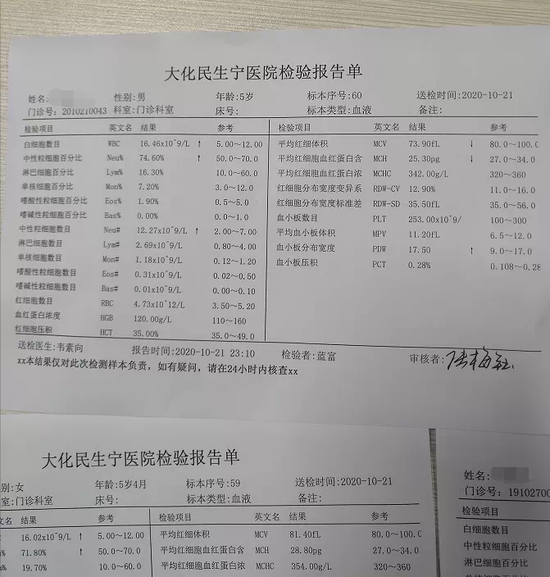

Baidu released [Unlimited-OCR-2](https://huggingface.co/baidu/Unlimited-OCR-2) (also called UnlimitedOCR2) as open weights on Hugging Face and [ModelScope](https://modelscope.cn/models/PaddlePaddle/Unlimited-OCR-2). It is a small document [vision-language model](/ai-glossary/vision-language-model/). It reads pages and returns text with layout tags, reading order, tables, and multi-page context. The model card describes Sparse Reference Sliding Window Attention (SR-SWA), which keeps long-document decoding cost from growing as fast as plain full attention.

I ran Unlimited-OCR-2 locally on Apple Silicon (MPS, fp32, Transformers). The PDF stayed on my machine. The test page was a Chinese hospital **[CBC](/med-glossary/全血细胞计数/) (complete blood count) + 5-part differential** sheet: one page, dense header, then a results grid. Headers and boxes read well. The dual-panel results grid did not: the model merged two side-by-side tables into one wrong HTML `<table>`. Below I describe the layout only. No patient identifiers and no real lab values from that file.

## What worked without extra code

On that page, full-page [inference](/ai-glossary/inference/) was already useful for everything *outside* the results grid:

- hospital title (Chinese and English)
- section labels (name, sex, age, specimen type, department, order item)
- timestamps and footer notes
- a `table[...]` block with a page-normalized bounding box

Runtime on an M4-class Mac: model load about 19 s, one dense page about 9 minutes in Transformers on MPS. The official docs assume NVIDIA CUDA. On Mac I patched two `.cuda()` calls in `masked_scatter_` and forced image tensors to fp32 (bf16 on MPS drifted). After that, local runs worked.

The output is not only a flat string. It returns text blocks, titles, an HTML `<table>`, and boxes. That structured markup is what I parse next.

## OCR issue when the page has two tables



*Example photo only. This is not the PDF I ran. It shows the same kind of [CBC](/med-glossary/全血细胞计数/) printout: one big rectangle, two result lists side by side, the same column headers on left and right, one vertical line between the lists, and almost no lines inside each list. Copies in a paper stack also overlap. That is why reading the whole page as one table fails.*

Hospital lab reports are often printed by a [lab computer system (LIS)](/med-glossary/实验室信息系统/). Many of those printouts put **two separate result lists on one page**. The left list is long ([WBC](/med-glossary/白细胞/) through [RDW-CV](/med-glossary/红细胞分布宽度/)). The right list is short ([RDW-SD](/med-glossary/红细胞分布宽度/) through [P-LCR](/med-glossary/大血小板比例/)). Both sides use the same headers: item, result, unit, reference range. The row counts do not match. People read left, then right. The model still tried to build **one** HTML table.

Unlimited-OCR-2 did that. Paddle-style table tools I tried on the same kind of sheet did the same. The print layout is the problem, not only one OCR tool. If your OCR output looks like one wide row that mixes left-panel and right-panel cells, you are hitting this dual-panel case.

A schematic of the bad HTML (synthetic values):

```html
<tr>
  <td>WBC</td><td>★白细胞计数</td><td>9.20↑</td><td>10^9/L</td>
  <td>3.5-9.5</td>
  <td>RDW-SD 红细胞分布宽度标准差</td><td>42.0</td><td>fL 40.0-53.0</td>
</tr>
```

The header said eight columns: item / result / unit / ref, twice. The model also split the left item into English abbr + Chinese name as two cells. Every later cell on that row moved one slot. On the right, unit and reference range sometimes landed in one cell. After the short right list ended, left-only rows continued with empty right cells. The model had joined left and right by row number.

Header text was fine. The error starts when the model is forced to invent one `<table>` for two lists of different length.

## Fix 1: cut left and right, run Unlimited-OCR-2 on each crop

Unlimited-OCR-2 already returns a table box on a 0-1000 page grid, for example `table[11, 247, 979, 753]`. I map that box to pixels, crop the results band, and cut it at the vertical middle. Each crop goes back into the **same** Unlimited-OCR-2 model. The prompt string is `"Free OCR."` That is an instruction built into Unlimited-OCR-2, not another OCR product.

```text
full page
   └─ table bbox
         ├─ left panel PNG  →  Unlimited-OCR-2
         └─ right panel PNG →  Unlimited-OCR-2
```

Each crop is one list. On the tested [CBC](/med-glossary/全血细胞计数/) PDF (not the photo above) I got 18 left rows and 6 right rows, and [PLT](/med-glossary/血小板/) stayed on the right. That is the membership error the full-page HTML got wrong.

Panel crops alone are not enough. On the left crop, `↑` was still mixed up with the unit column, and many reference ranges were missing. The right crop was cleaner. Cutting the page stops left/right mixing. It does not fix every column mix-up inside one side.

## Fix 2: repair the shifted full-page HTML

The broken full-page `<table>` still has the right words and numbers. They sit in the wrong cells. For this hospital printout the repeating pattern is:

```text
code | chinese_name | value | unit | ref | right_item | right_value | right_unit_ref
```

while the right list still has a row, then left-only rows after that.

A small parser walks each `<tr>`. If cell 0 looks like a lab code and cell 1 is Chinese, the first five cells are one left result. The rest of the row is the right result. Synthetic example:

| panel | code | name | value | flag | unit | ref |
|-------|------|------|-------|------|------|-----|
| left | [WBC](/med-glossary/白细胞/) | ★白细胞计数 | 9.20 | ↑ | 10^9/L | 3.5-9.5 |
| right | [PLT](/med-glossary/血小板/) | ★血小板计数 | 200 |  | 10^9/L | 125-350 |

That is enough for JSON or Markdown without another model call. The left/right crops are still useful to check that the repaired rows match the two sides.

## Limits

- Unlimited-OCR-2 does not know, by itself, that this printout is two lists. Extra code has to split left and right, or repair the HTML. Switching to another open OCR tool does not remove that step for this layout.
- Mac MPS is fine for local tests. It is slower and less supported than the NVIDIA CUDA + SGLang setup in the official docs.
- The HTML repair above matches this hospital's column order. A different lab printout may need different repair code.

## Steps I use

1. Rasterize the PDF locally (I used 300 DPI).
2. Run Unlimited-OCR-2 once on the full page. Keep the layout markup and the table box.
3. If the HTML looks like an 8-column merge with abbr and Chinese name split apart, repair it with the row parser above.
4. Optionally crop left and right and run Unlimited-OCR-2 again to check panel counts.
5. Export `{code, name, value, flag, unit, ref, panel}` records. Do not send the raw merged `<table>` into clinical logic.

Unlimited-OCR-2 is strong on Chinese hospital headers and boxes. On dual-panel [CBC](/med-glossary/全血细胞计数/) sheets, the remaining gap is simple: the page is two lists, not one table, even when both lists sit inside one rectangle. Split the page, or repair the HTML, and keep the PDF local.

## References

1. <span id="ref-unlimited-ocr-2"></span>Baidu ERNIE Team. “Unlimited OCR Works 2: Pioneering the OCR-3.0 Era: From Long- to Unlimited-Horizon Parsing.” arXiv preprint, 2026. [arXiv:2610.39308](https://arxiv.org/abs/2610.39308){:target="_blank" rel="noopener noreferrer"}.  
   Read in [BetterReads](https://www.betterreads.dev/reader?bookId=unlimited_ocr_works_2&type=pdf&preview=1){:target="_blank" rel="noopener noreferrer"}