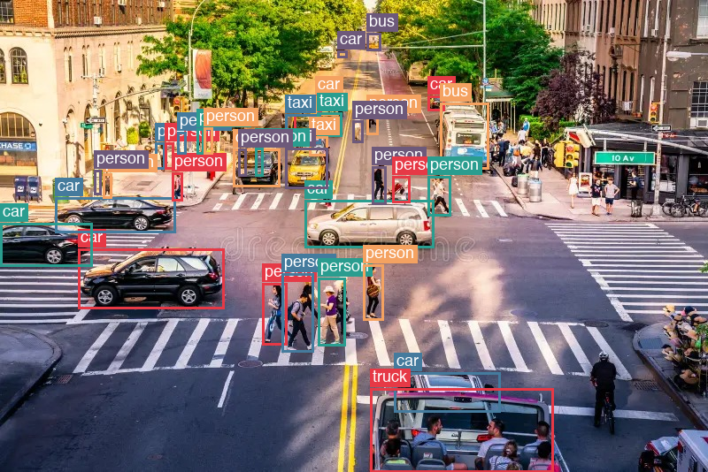

Autonomous-driving demos put colored rectangles on cars and people. In computer vision, that link from a phrase ("person in the crosswalk", "yellow taxi") to a region in the frame is **visual grounding**. The rectangle is how you draw the region. This is not the RAG sense of [grounding](/ai-glossary/grounding/), which means tying answers to documents.

A [vision-language model](/ai-glossary/vision-language-model/) (VLM) can do a still-image version of that. I pass a traffic photo and a text prompt. The model writes JSON with labels and coordinates. Code parses that string, draws the boxes with Pillow, and writes a PNG. Production AVs usually run dedicated detectors and trackers on video. Below is only the VLM path on one photo, [zero-shot](/ai-glossary/zero-shot/) [inference](/ai-glossary/inference/) on Apple Silicon (MPS).

What I cover:

1. the VLM stack (vision encoder, projector, LLM)
2. why the coordinates arrive as JSON text, not as box [tensors](/ai-glossary/tensor/) from a [detection head](/ai-glossary/detection-head/)
3. the local inference loop that writes the annotated PNG

## What a VLM is

Most open VLMs look like this:

```text
image  →  vision encoder  →  projector  →  LLM embedding space
                                              ↓
text prompt  →  tokenizer  →  token embeddings ─┘
                                              ↓
                                    next-token generation
                                              ↓
                                         text (maybe JSON boxes)
```

- **Vision encoder.** Turns the frame into a sequence of vectors (patches / tiles). That is what lets the model take a photo of a crowded intersection as input, not only a text description of traffic.
- **Projector.** Maps those vectors into the same width as the language [tokens](/ai-glossary/token/), so vision and text sit in one sequence. You can ask "box every pedestrian in the crosswalk" on the same model that answers in English.
- **LLM.** An [instruct](/ai-glossary/instruct-model/) language model that writes the reply. For grounding, the reply is often JSON with labels and coordinates. There is no separate [detection head](/ai-glossary/detection-head/). The numbers are more text.

I used `Qwen/Qwen3-VL-4B-Instruct` from Hugging Face via `transformers`. The first load pulls the weights onto disk; after that, [inference](/ai-glossary/inference/) runs locally on MPS. There is no live call to Hugging Face per image.

When I ask "where are the pedestrians?", the model does **not** return a [tensor](/ai-glossary/tensor/) of boxes. It returns a string, for example `[{"label":"person","bbox_2d":[120,80,640,900]}]`. Parsing that string, mapping the numbers to pixel corners, and drawing rectangles is ordinary post-processing. The VLM stops at text.

## Why boxes make a useful check

Captioning returns a sentence ("a busy street"). Grounding returns coordinates you can paint on the cars and people. If the PNG looks wrong, the failure is obvious: missed pedestrian, box on the wrong car, box too large, or unparsable JSON.

I ask for a fixed JSON schema with `bbox_2d` in **0-1000** (relative to width and height). That matches how Qwen3-VL is usually prompted for locations. Post-processing maps those numbers back to pixels and draws rectangles.

## Inference on Mac (MPS)

Stack: PyTorch with MPS, `transformers`, Pillow. Model id: `Qwen/Qwen3-VL-4B-Instruct` in float16.

The prompt asks for every car / bus / truck / taxi / pedestrian as a JSON array, one object per detection, `bbox_2d` in 0-1000.

Loop:

1. pick **MPS** if available, else CPU
2. load the model and processor
3. apply the model’s [chat template](/ai-glossary/chat-template/) with one image + text
4. generate text, parse the JSON list (with a regex fallback when the model packs duplicate keys into one object)
5. draw labeled colored boxes with Pillow and write a PNG

Core call:

```python
messages = [{
    "role": "user",
    "content": [
        {"type": "image", "image": image},
        {"type": "text", "text": query},
    ],
}]
inputs = processor.apply_chat_template(
    messages,
    tokenize=True,
    add_generation_prompt=True,
    return_dict=True,
    return_tensors="pt",
)
inputs = inputs.to(device)
out_ids = model.generate(**inputs, max_new_tokens=1024)
```

After generation: parse `bbox_2d`, scale 0-1000 → pixels, `ImageDraw.rectangle`.


**Code:** [gist](https://gist.github.com/zlu/03bcf47228b6b2c6bd107e9869a5602a)


## What I actually saw on this photo

I first tried `Qwen3-VL-2B-Instruct` on the same NYC still. It mostly returned cars, often as one malformed JSON object with many repeated `"bbox_2d"` keys, and it skipped the bus and the people in the crosswalk. Tiny distant boxes also piled up in one lane.

`Qwen3-VL-4B-Instruct` on the same prompt and image returned cars, taxis, a bus, and many `person` boxes. The raw string still packed several detections into single objects (duplicate keys). Standard `json.loads` keeps only the last key of each name, so I walk `"label"` / `"bbox_2d"` pairs with a regex before drawing. Save the raw model string next to the PNG; that is how you separate parse failures from localization failures.

| Check | What it tells you |
|---|---|
| Raw model string | Schema drift, truncated JSON, duplicate keys |
| Annotated PNG | Spatial success or failure, independent of how fluent the text looks |
| Parsed box count | Parse success; zero boxes with a long raw dump means format failure, not "empty scene" |

## VLM box text vs a detector

| | VLM grounding (this post) | Classical detector (YOLO / RetinaNet) |
|---|---|---|
| Output | Text tokens (JSON / box markup) | Box [tensors](/ai-glossary/tensor/) from a [detection head](/ai-glossary/detection-head/) |
| Train signal (if you fine-tune later) | Token cross-entropy on the string | Localization + classification losses |
| Runtime job here | Chat over an image | Dense predict-and-NMS |

Same screenshot can come from either path. The mechanism is not the same. This demo only shows the VLM path.

## Takeaways

- A VLM is vision vectors projected into an LLM, then ordinary next-token generation.
- Grounding is useful because you can see the answer on the image.
- On a Mac, `Qwen3-VL-4B-Instruct` + MPS is enough to run the loop and save PNGs. 2B was too weak on this dense intersection.
- Keep the raw string next to the drawing. Parse failures and localization failures look similar on the PNG if you only keep the picture.
