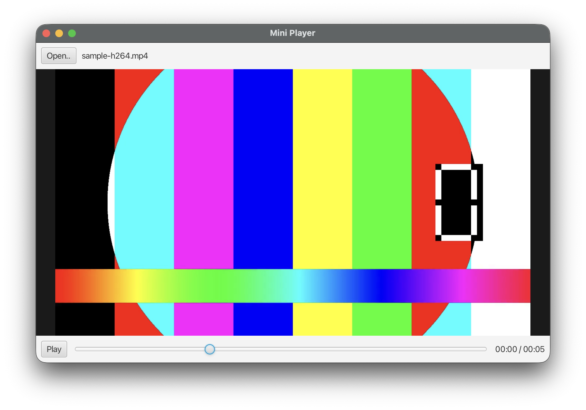

[JavaFX](https://openjfx.io/) is the usual replacement when you want a richer desktop UI than Swing. Swing still ships in the JDK. JavaFX does not; it is a separate OpenJFX project you pull in with Maven.

I built a small player that opens a local file and plays it. Source: [github.com/zlu/javafx-mini-player](https://github.com/zlu/javafx-mini-player). The rest of this post walks through that app in build order: window, button, file picker, playback, then the seek slider.



```sh
git clone https://github.com/zlu/javafx-mini-player.git
cd javafx-mini-player
mvn javafx:run
```

You need JDK 21+ (the sample targets JavaFX 25, so newer is safer) and Maven 3.9+ to build the app. The repo ships a short H.264/AAC `sample-h264.mp4`. Use that first; random downloads can fail for codec reasons (more on that at the end).

## Maven

Two artifacts are declared as dependencies: `javafx-controls` for buttons and layout, `javafx-media` for playback. The `javafx-maven-plugin` puts those modules on the path when you run `mvn javafx:run`, so you do not install a separate JavaFX SDK by hand.

```xml
<dependency>
  <groupId>org.openjfx</groupId>
  <artifactId>javafx-controls</artifactId>
  <version>${javafx.version}</version>
</dependency>
<dependency>
  <groupId>org.openjfx</groupId>
  <artifactId>javafx-media</artifactId>
  <version>${javafx.version}</version>
</dependency>
```

I also pass `--enable-native-access=javafx.graphics,javafx.media` on the plugin so newer JDKs stop warning about restricted native calls.

## 1. Open a window

In Swing you would create a `JFrame`, put a `JPanel` in it, and call `setVisible(true)`. JavaFX splits that into a few named pieces.

| Piece | Role |
| --- | --- |
| `Application` | entry class; you override `start(Stage)` |
| `Stage` | the OS window (title, size, show/hide) |
| `Scene` | what fills the window: size, root node, optional CSS |
| scene graph | tree of `Node`s under that root (`Button`, `Label`, `MediaView`, …) |

If you have used Unity, the scene graph is the same idea as a hierarchy of GameObjects: a tree the runtime walks each frame. `Stage` is just the window that hosts that tree. It is not a game engine; there is no Transform or Update loop you write yourself.

`main` only boots the toolkit with `launch()`. Do not `new MiniPlayerApp()` yourself.

```java
public static void main(String[] args) {
    launch(args);  // toolkit constructs Application, then calls start(Stage)
}
```

Minimal `start`: one empty `BorderPane` as the root, wrap it in a `Scene`, show the `Stage`.

```java
@Override
public void start(Stage stage) {
    BorderPane root = new BorderPane();
    stage.setTitle("Mini Player");
    stage.setScene(new Scene(root, 800, 500));
    stage.show();
}
```

`start` runs on the JavaFX Application Thread. Put UI work there. Background work that touches controls has to bounce back with `Platform.runLater`.

**FXML.** Bigger apps often put the same tree in an `.fxml` XML file and load it with `FXMLLoader`. [Scene Builder](https://gluonhq.com/products/scene-builder/) is the drag-and-drop editor for that: place controls, set properties, write `.fxml`. IntelliJ IDEA and Eclipse can open those files with Scene Builder as the visual editor (similar to Android Studio's layout preview). VS Code and NetBeans have weaker support. For a one-class sample I build the graph in Java so every listener sits next to the control it touches.

## 2. Add chrome: Open button and a video area

Inside the `BorderPane` I place a top bar, a center area for video, and transport controls (play/pause, slider) on the bottom.

```java
MediaView mediaView = new MediaView();
StackPane center = new StackPane(mediaView);
center.setStyle("-fx-background-color: #1a1a1a;");
mediaView.fitWidthProperty().bind(center.widthProperty());
mediaView.fitHeightProperty().bind(center.heightProperty());
mediaView.setPreserveRatio(true);

Button open = new Button("Open…");
Label status = new Label("No media");
HBox top = new HBox(8, open, status);

Button playPause = new Button("Play");
Slider seek = new Slider(0, 100, 0);
Label timeLabel = new Label("00:00 / 00:00");
HBox bottom = new HBox(8, playPause, seek, timeLabel);

BorderPane root = new BorderPane();
root.setTop(top);
root.setCenter(center);
root.setBottom(bottom);
```

`MediaView` is the node that draws frames once a `MediaPlayer` is attached. Until then the center pane is just a dark rectangle. Play/Pause and the slider stay disabled until a file is ready.

## 3. Hook Open to a FileChooser

`setOnAction` is the JavaFX click listener (Swing's `ActionListener` equivalent).

```java
open.setOnAction(e -> openFile(stage));
```

`FileChooser.showOpenDialog(stage)` blocks until the user picks a file or cancels. Cancel returns `null`.

```java
private void openFile(Stage stage) {
    FileChooser chooser = new FileChooser();
    chooser.setTitle("Open media");
    chooser.getExtensionFilters().add(
            new FileChooser.ExtensionFilter(
                    "Video", "*.mp4", "*.m4v", "*.aif", "*.aiff", "*.wav"));
    File file = chooser.showOpenDialog(stage);
    if (file == null) {
        return;
    }
    load(file);
}
```

## 4. Play the file: Media, MediaPlayer, MediaView

| Type | Role |
| --- | --- |
| `Media` | source URI (`file:` URL for a local path) |
| `MediaPlayer` | play / pause / seek; exposes time properties |
| `MediaView` | scene-graph node that paints decoded frames |

```java
private void load(File file) {
    disposePlayer();  // stop any previous file first
    status.setText(file.getName());

    Media media = new Media(file.toURI().toString());
    MediaPlayer player = new MediaPlayer(media);
    mediaPlayer = player;

    mediaView.setMediaPlayer(player);
}
```

That is not enough to call `play()` yet. After `new MediaPlayer(media)`, duration and many properties are still invalid. The player has to finish opening the file and reach status `READY`. `setOnReady` registers a callback for that moment: you pass a runnable, the toolkit runs it later on the Application Thread.

```java
player.setOnReady(() -> {
    Duration total = player.getTotalDuration();
    seek.setMax(total.toMillis());
    seek.setDisable(false);
    playPause.setDisable(false);
    playPause.setText("Pause");
    timeLabel.setText(format(Duration.ZERO) + " / " + format(total));
    player.play();
});
```

Inside that callback I set the slider max to the media length in milliseconds, enable Play/Pause and the slider, then call `play()` for the first time. If you call `getTotalDuration()` or `play()` right after construction, you often get unknown duration or a no-op. Wait for ready.

Codec and container failures usually land on error handlers, not as a thrown Java exception:

```java
media.setOnError(() -> Platform.runLater(() ->
        status.setText("Media error: " + media.getError())));
player.setOnError(() -> Platform.runLater(() ->
        status.setText("Player error: " + player.getError())));
```

Play/Pause is ordinary button wiring against `MediaPlayer`:

```java
playPause.setOnAction(e -> {
    if (mediaPlayer.getStatus() == MediaPlayer.Status.PLAYING) {
        mediaPlayer.pause();
        playPause.setText("Play");
    } else {
        mediaPlayer.play();
        playPause.setText("Pause");
    }
});
```

## 5. How the seek slider works

While the file plays, the player updates [`currentTimeProperty()`](https://openjfx.io/javadoc/25/javafx.media/javafx/scene/media/MediaPlayer.html#currentTimeProperty()). I copy that into the slider so the thumb tracks the clock:

```java
player.currentTimeProperty().addListener((obs, oldT, newT) -> {
    if (!seeking) {
        seek.setValue(newT.toMillis());
    }
    timeLabel.setText(format(newT) + " / " + format(player.getTotalDuration()));
});
```

When the user drags the thumb, JavaFX sets `valueChangingProperty` to `true` for the duration of the drag. If I kept writing `currentTime` into the slider during that drag, the thumb would jump back to the playhead on every tick. So:

1. On drag start: set `seeking = true` (skip clock → slider writes).
2. On drag end (`changing` goes back to `false`): call `mediaPlayer.seek(...)` with the slider value.

```java
private boolean seeking;

seek.valueChangingProperty().addListener((obs, was, changing) -> {
    seeking = changing;
    if (!changing && mediaPlayer != null) {
        mediaPlayer.seek(Duration.millis(seek.getValue()));
    }
});
```

A click on the track (no drag) may leave `valueChanging` false the whole time. I also seek on mouse release for that case:

```java
seek.setOnMouseReleased(e -> {
    if (mediaPlayer != null && !seek.isValueChanging()) {
        mediaPlayer.seek(Duration.millis(seek.getValue()));
    }
});
```

End to end: clock drives the slider while idle; user drag owns the thumb; releasing the mouse tells the player where to jump.

## Dispose before opening another file

Native decoder state does not vanish when you drop the Java reference. Before loading a second file (and on window close), stop and dispose the old player:

```java
private void disposePlayer() {
    MediaPlayer old = mediaPlayer;
    mediaPlayer = null;
    mediaView.setMediaPlayer(null);
    if (old != null) {
        old.stop();
        old.dispose();
    }
}
```

I clear the field first so late `currentTime` callbacks from the dying player can no-op safely.

## Codec limits (why the sample MP4 is in the repo)

JavaFX Media is not VLC. Supported containers and codecs depend on the OS backends (AVFoundation on macOS, etc.). A file that plays in QuickTime or VLC can still fail here.

I hit that with a movie file: OpenJFX refused it (black video / error path) while other players were fine. That is why the repo includes `sample-h264.mp4`. Start with that file. If your own MP4 fails, convert to a short H.264/AAC MP4 that already plays in the OS player, or replace the engine (libVLC via `vlcj` is the common JVM path).

On macOS, prefer JavaFX 23+ for local video; 21 had an AVFoundation bug that showed audio with a black frame. The sample uses 25.x.

## What I skipped

- External CSS and a full FXML layout
- Playlist, volume, mute, fullscreen
- Packaging a self-contained installer
- Shipping native codec bundles and the license work that comes with them
