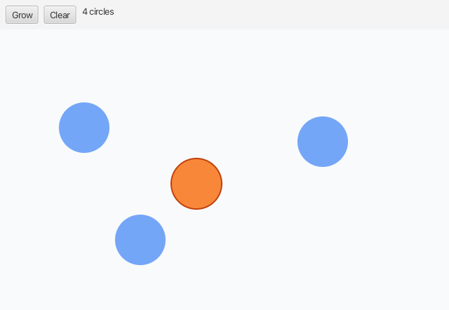

If you learned desktop UI on AWT or Swing, JavaFX will feel familiar for a reason. `ActionListener`, `MouseListener`, Swing's `PropertyChangeListener`, and JavaFX's `EventHandler` / `ChangeListener` / `bind` are the same design idea under different names: the **Observer** pattern. A subject holds state (or fires an input event). Observers register. When something changes, the subject notifies; nobody polls in a loop.

That is where the "data backing" for a UI comes from. Not a special JavaFX invention. AWT already routed button presses through listeners. Swing kept that and added JavaBeans-style property change events for many component fields. JavaFX pushes the same Observer contract further: every interesting field on a node is a first-class `Property`, lists of children are `ObservableList`s, and `bind` wires one observable to another so you stop writing the notify/update boilerplate by hand.

The sample below is a small window that drops a circle on empty clicks, highlights the circle you click, and grows every circle from one shared radius. It is a tour of Observer in three places: mouse/button events, a `DoubleProperty` that nodes subscribe to, and a list listener on `getChildren()`.

Source: [github.com/zlu/javafx-click-circles](https://github.com/zlu/javafx-click-circles). Maven / OpenJFX setup matches [Play a local MP4 with JavaFX Media](/2026/11/22/javafx-media-local-mp4/); this sample only needs `javafx-controls`.

```sh
git clone https://github.com/zlu/javafx-click-circles.git
cd javafx-click-circles
mvn javafx:run
```



## Observer

Classic roles:

| Role | Meaning | In this sample |
| --- | --- | --- |
| subject | holds a value or can fire an event | `DoubleProperty radius`, `drawing.getChildren()`, the `Pane` that receives clicks |
| observer | registered interest | `EventHandler`, `ChangeListener`, `ListChangeListener`, or a bound `radiusProperty()` |
| notify | subject tells observers after a change | click delivered, `radius.set(...)`, child added/removed |

AWT: `button.addActionListener(...)`. Swing: same, plus `addPropertyChangeListener` on beans. JavaFX: `setOnAction` / `addEventFilter` for input; `property.addListener` or `other.bind(property)` for data. Same pattern. The rest of the post is that pattern applied to circles.

## Window and Pane

`Pane` places children by each node's own coordinates. A `Circle` uses `centerX` / `centerY` / `radius`, so click coordinates map straight onto the circle. `BorderPane` or `VBox` would fight you here; they own layout.

Put the drawing surface in the center and chrome (Grow, Clear, status) on top. That way the buttons are not mixed into `drawing.getChildren()` next to the circles.

```java
Pane drawing = new Pane();
drawing.setPrefSize(640, 400);

Button grow = new Button("Grow");
Button clear = new Button("Clear");
Label status = new Label();

HBox top = new HBox(8, grow, clear, status);
BorderPane root = new BorderPane();
root.setTop(top);
root.setCenter(drawing);
```

## Mouse click → create or select

`MouseEvent` has a **target**: the deepest node under the pointer. Click empty pane area and the target is the `Pane`. Click a circle and the target is that `Circle`. I register an **event filter** on the drawing pane so every click in that area runs through one place, then branch on the target.

```java
drawing.addEventFilter(MouseEvent.MOUSE_CLICKED, e -> {
    if (e.getTarget() instanceof Circle c && drawing.getChildren().contains(c)) {
        selected.set(c);   // ObjectProperty<Circle>
        e.consume();
        return;
    }
    Circle c = new Circle(e.getX(), e.getY(), radius.get());
    c.setFill(FILL_NORMAL);
    c.radiusProperty().bind(radius);
    drawing.getChildren().add(c);
    selected.set(c);
});
```

Selection is visual only: a `ChangeListener` on `selected` restyles the previous circle (blue, no stroke) and the new one (orange fill + stroke). Grow still scales **all** circles; selection does not change who grows.

| Click | Target | Action |
| --- | --- | --- |
| empty pane | `Pane` | create circle at `(getX(), getY())`, select it |
| existing circle | `Circle` | select that circle (color change) |

That is Observer for **input** (AWT/Swing listeners under a JavaFX API):

| Piece | Role |
| --- | --- |
| event type | `MouseEvent.MOUSE_CLICKED`, `ActionEvent` on a button, … |
| target | the `Node` under the pointer (or the control that fired) |
| filter / handler | the observer; filter on the parent sees child hits too |
| scene graph | after you mutate it, the next pulse redraws |

Handlers answer "something happened." They do not by themselves keep two values in sync. For that you need Observer on **data**: properties.

## Grow, way A: walk getChildren

The blunt approach. On each button press, scan the drawing pane, keep only `Circle` nodes, multiply radius by a factor.

```java
final double growFactor = 1.25;

grow.setOnAction(e -> {
    for (Node n : drawing.getChildren()) {
        if (n instanceof Circle c) {
            c.setRadius(c.getRadius() * growFactor);
        }
    }
});
```

`getChildren()` returns an `ObservableList<Node>`. Everything in that list is a `Node`, so you need `instanceof` (pattern match in modern Java) before you can call `setRadius`. It works. It also couples the button to the current child list: add a `Label` overlay later and you must remember the filter.

This is push-by-search: every grow action re-discovers the circles and writes a new radius. The sample repo does **not** use this path for Grow; it is the teaching contrast.

## Grow, way B: DoubleProperty + bind

JavaFX nodes expose bean-style properties: `radiusProperty()`, `centerXProperty()`, and so on. That line goes back through Swing/JavaBeans: a field is not only a getter/setter; it is a subject that can notify. A JavaFX `Property` is an observable value. `bind` registers the dependent property as an observer and copies updates for you.

Own one shared radius. Bind each new circle's `radiusProperty` to it. The Grow button only multiplies the shared value. Every bound circle grows, selected or not.

```java
DoubleProperty radius = new SimpleDoubleProperty(20);
final double growFactor = 1.25;

// when creating each circle:
c.radiusProperty().bind(radius);

grow.setOnAction(e -> radius.set(radius.get() * growFactor));
```

After `bind`, every bound circle tracks `radius`. The button never calls `getChildren()` or `instanceof`. One subject, many observers. That is the data backing: the radius lives in a property; the scene graph does not own a private copy you have to hunt down.

Multiply (rather than `+ 5`) makes the shared-value story obvious. Click Grow a few times and every circle scales by the same factor, including circles you add later (they start at the current `radius.get()`).

### Bind gotcha

A unidirectional bind makes the circle's radius read-only from your code. `c.setRadius(...)` after `bind` throws. To grow, set the source property (`radius.set(...)`), or `unbind()` first. That constraint is the point: the property owns the value; the node follows.

### ChangeListener (middle ground)

If you do not want bind, you can still avoid scanning only at button time by listening to the property and then writing radii. That is still a manual fan-out. Prefer `bind` when each node has a matching property.

## ObservableList listener

`getChildren()` is not a plain `ArrayList`. It is an `ObservableList`. You can listen for add/remove without touching Grow:

```java
drawing.getChildren().addListener((ListChangeListener<Node>) change -> {
    long n = drawing.getChildren().stream().filter(c -> c instanceof Circle).count();
    status.setText(n + (n == 1 ? " circle" : " circles"));
});
```

Create and Clear both mutate the list; the label updates from the list change, not from duplicated `status.setText` calls at every call site. Same Observer idea as `DoubleProperty`: the collection is the subject; UI that cares about membership registers as an observer.

## Clear and unbind

Before removing bound circles, unbind so the shared property is not still wired to nodes you are about to drop:

```java
selected.set(null);
for (Node n : drawing.getChildren()) {
    if (n instanceof Circle c) {
        c.radiusProperty().unbind();
    }
}
drawing.getChildren().clear();
radius.set(20);  // reset for the next batch
```

JavaFX bindings often use weak listeners, so a removed node is usually eligible for GC even without `unbind`. Explicit unbind is clearer in teaching code and avoids surprises if something else still holds a reference to the `Circle`.

## Observer, twice

AWT and Swing already split "input happened" from "a bean field changed." JavaFX keeps that split and makes the data side heavier.

| Subject | Trigger | Observer API | Lineage |
| --- | --- | --- |
| control / pane | user input | `setOnAction`, `addEventFilter` | AWT/Swing listeners |
| `Property` | value changed | `bind`, `addListener` | JavaBeans / Swing `PropertyChangeListener` |
| `ObservableList` | membership changed | `addListener` | same Observer idea on a collection |

Events: click target is pane or circle → create or select.  
Properties: Grow writes `radius` → all bound circles follow.  
List: children change → status label updates.

Way A (walk `getChildren` and `setRadius`) skips the data Observer: the button handler reaches into the graph and pushes. Way B keeps the radius in a subject and lets nodes observe it. That is the upgrade from "listener that mutates widgets" to "listener that mutates the model the widgets already observe."

## Summary

1. Observer is the backing model: AWT/Swing listeners for input, beans/properties for data.
2. Event filter on the pane: empty click creates a circle; circle click selects (color).
3. Grow by search (contrast): loop children, `instanceof Circle`, `setRadius(r * factor)`.
4. Grow by property (sample): `SimpleDoubleProperty`, `radiusProperty().bind(radius)`, button does `radius.set(radius.get() * factor)` for **all** circles.
5. `ObservableList` listener keeps the count label honest.
6. Clear unbinds, then `getChildren().clear()`.

For anything past a toy, put shared state in a property (or a small model of properties) and let the scene graph observe it. Walking `getChildren` is a good teaching contrast and a last resort when you do not control how nodes were created.
