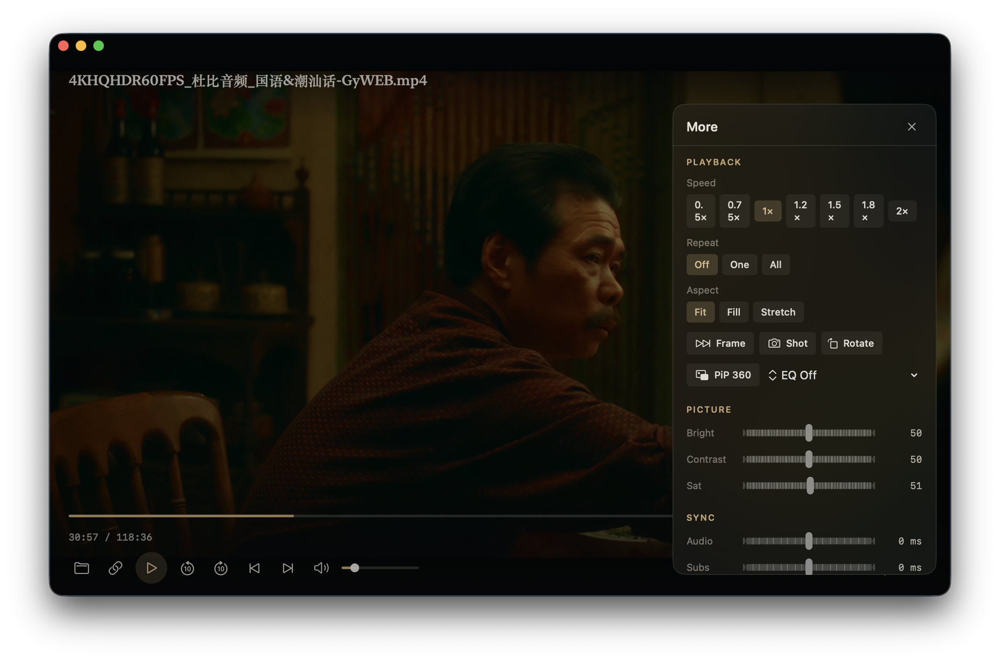





<main>
  <section class="lume-hero lume-wrap">
    

      <h1>Lume</h1>
      
Cinema chrome. Real codecs.

      

        A Mac player for local files and network streams. Open a folder, drop a file, or paste a URL. Built on VLCKit.
      

      

        <a class="lume-btn lume-btn-primary" href="{{ dl }}">Download for Mac</a>
        <a class="lume-btn lume-btn-ghost" href="#features">Features</a>
      

      
Apple Silicon · macOS 14+ · 7-day trial · $19 one-time

    

    

      
    

  </section>

  <section class="lume-features lume-wrap" id="features">
    
Features

    <ul class="lume-feature-grid">
      <li class="lume-feature">
        <h3>Local + queue</h3>
        
Multi-select open, drag-and-drop, playlist advance, and continue watching on launch.

      </li>
      <li class="lume-feature">
        <h3>Network URL</h3>
        
Paste HTTP streams or site pages. yt-dlp resolves YouTube and friends when available.

      </li>
      <li class="lume-feature">
        <h3>VLCKit codecs</h3>
        
The formats you already expect from VLC, in a native SwiftUI shell.

      </li>
      <li class="lume-feature">
        <h3>Scrub preview</h3>
        
Seek with thumbnail previews for local files via ffmpeg helpers.

      </li>
      <li class="lume-feature">
        <h3>Captions</h3>
        
Sidecar SRT/VTT, embedded tracks, delay nudge, and optional live ASR.

      </li>
      <li class="lume-feature">
        <h3>A-B loops</h3>
        
Mark loops per video, save them beside the file, jump back from the drawer.

      </li>
      <li class="lume-feature">
        <h3>Cinema chrome</h3>
        
Autohide controls, translucent drawer, picture adjust, aspect and rotate.

      </li>
      <li class="lume-feature">
        <h3>PiP + pin</h3>
        
Floating picture-in-picture sizes, always-on-top, fullscreen, keyboard map.

      </li>
      <li class="lume-feature">
        <h3>One-time license</h3>
        
Full trial for seven days. Then $19 via Polar. No subscription.

      </li>
    </ul>
  </section>
</main>


